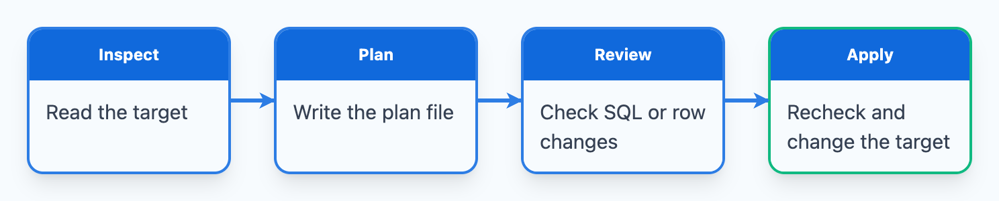

# Migrations

Start with the source that describes what you want to change. HCL reconciles a declared schema, SQL runs deployment scripts, and CSV reconciles rows in existing tables.

| Source | Use it for | Targets |
| --- | --- | --- |
| [HCL schema migrations](./hcl) | Declare tables, columns, and constraints and generate the SQL to reconcile them | PostgreSQL, SQLite, SQL Server |
| [SQL script migrations](./sql) | Version deployment scripts, order dependencies, and review what will run | SQL Server apply, PostgreSQL advisory preview |
| [CSV data migrations](./csv) | Preview inserts, updates, and deletes from CSV and YAML mappings | SQL Server |
| [Compare two databases](../migrations) | Inspect two saved connections and turn selected schema differences into a patch | PostgreSQL, SQLite, SQL Server |

## Plan, review, and apply

1. **Inspect.** Identify the target and the scope you intend to change. Use a DSN, a SQLite file path, or a [saved connection](../connections).
2. **Plan.** Run `sqlglot migrate plan` with the source and target. Planning reads the target, prints a summary, and writes `.sqlglot-go/plan.json` by default. Use `--out` to choose a different path.
3. **Review.** Run `sqlglot migrate review PLAN` to inspect the saved file offline. Check the target, warnings, SQL or row counts, and any destructive changes. Keep the reviewed file intact so its integrity hash remains valid.
4. **Apply.** Run `sqlglot migrate apply --dsn TARGET PLAN`. Apply rechecks the target against the plan before executing it. If it reports a stale plan, plan again and review the new file. CSV plans also need the original source root, filters, and phase at apply time.

For PostgreSQL, SQLite, and CSV plans, pass one `--ack` per destructive item that you reviewed. The source guides explain how to find the required identifiers. After applying, inspect the resulting schema or data before proceeding.

## Configuration reference

- [Project YAML](./project-yaml) for target aliases, source selection, labels, and CEL transforms.
- [CSV mapping YAML](./csv-yaml) for tables, keys, layers, and delete modes.
- [Supported HCL](./hcl-reference) for dialect-specific blocks, types, and restrictions.
- [SQL script headers](./sql-headers) for phases, dependencies, reruns, and transactions.
