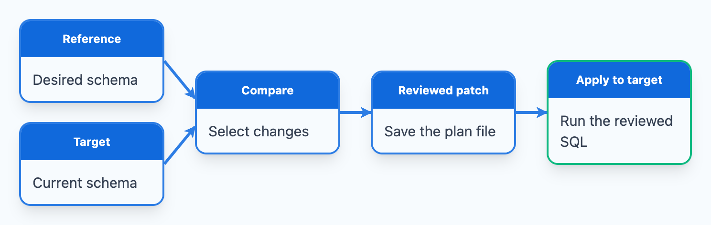

# Compare, review, and apply a migration

This guide follows one complete migration: choose two saved connections, inspect the differences, create a patch, leave and resume the review, then apply it to the target. Start with [Add connections and inspect a database](./inspection) if you have not saved your connections yet. For file-based migrations, see the [migration guides](./migrate/index.md).

The example uses `inventory-reference` and `inventory-target`. The reference's `items` table has a `notes` column that the target is missing. Both databases already contain two rows.

## 1. Choose the saved connections

Start the app if it is not already running:

```sh
sqlglot ui
```

1. Open **Compare**.
2. Under **Reference (desired)**, select `inventory-reference`.
3. Under **Target (to patch)**, select `inventory-target`.
4. Leave the optional **Schemas** field empty for this example.
5. Click **Compare**.

You can use **New connection** beside either picker if a connection has not been added yet. The two connections must point to distinct databases of the same kind. Check the direction before continuing: the reference supplies the desired schema, and the target receives the changes.

## 2. Read the differences

The review opens with the connection names and counts of added, changed, and dropped objects.

1. In **Changes**, open the `items` table.
2. Read its **Diff** to see what is present in the reference and missing from the target.
3. Open **Migration SQL** to read the SQL for the selected changes.
4. Check the box for adding `notes`.

For the SQLite example, the SQL adds one nullable column:

```sql
ALTER TABLE `items` ADD COLUMN `notes` text NULL
```

Review the checked changes even if they were selected automatically. Leave changes you do not want unchecked. Destructive changes are identified in the review; they require explicit acknowledgement before apply.



## 3. Create the patch

Click **Create patch (1)** for the example's single selected change. If the selection needs another change, use **Add required changes**, review the expanded selection, and then create the patch.

The patch screen shows:

- **Patch** — the number of selected changes and the plan file's hash.
- **SQL script** — the statements the patch will execute.
- **Apply to the target** — the command for applying this plan file to the selected target.

Read the SQL and confirm the target connection. Click **plan.json** to download the plan file. You can also download **patch.sql** for a readable copy of the SQL. Keep the plan file unchanged after reviewing it: its hash guards its integrity, so an edited file is refused.

Creating the patch checks the databases again. If their schemas changed since the comparison, use **Re-compare** and review the new differences before making another patch.

## 4. Leave and resume the work

You can close the browser and return later. If you also stopped sqlglot, run `sqlglot ui` again on the same computer and user account.

### Reopen a comparison

1. Open **History**.
2. Choose **Comparison** and, if helpful, select `inventory-target` in the **Connection** filter.
3. Find the run by its connection names and time.
4. Click its time to reopen the comparison review.

You can inspect its saved differences and choose changes without contacting either database. The notice at the top says the comparison was recorded. Creating a new patch contacts the databases and checks whether that comparison is still current.

If you want to preserve your exact selection and focused object, bookmark the review page before leaving. The page address retains those choices. Opening a comparison from History restores the comparison and starts with its default selection, so review the checked changes again.

### Reopen a patch

1. In **History**, choose **Patch**.
2. Open the patch by its time.
3. Review the saved SQL, download **plan.json** again if needed, or copy the same apply command.

Reopening a patch does not regenerate or apply it. Its saved contents remain available if a database is offline. You can also bookmark the patch page to return directly to it.

### Get a fresh comparison

Click **Re-compare** when you need the latest schema state. It runs a new comparison and keeps the earlier run in History. A saved comparison is a record of the past, not a live view of the database.

## 5. Apply the reviewed patch

The browser prepares and downloads the patch; execution happens in the terminal.

1. Put the downloaded `plan.json` in your working folder.
2. In **Apply to the target**, click **Copy command**.
3. Open a terminal in that folder.
4. Read the command and confirm that its connection is `inventory-target`.
5. Run the copied command.

The command has the form `sqlglot migrate apply --dsn <target> [--ack <id>…] plan.json`: the saved target connection, any required destructive acknowledgements, and the plan file as its last argument. You do not need to assemble these values manually, and there is no hash to pass: apply checks the file's own hash and refuses the plan, running nothing, if the target changed since it was planned. Review destructive changes before running a command that acknowledges them.

A successful apply reports `applied`. For the SQLite example, one step adds `notes` and the two existing rows remain. You can check them from the folder containing the database:

```sh
sqlite3 inventory-target.db 'SELECT id, label, notes FROM items ORDER BY id;'
```

Expected result:

```text
1|Notebook|
2|Pencil|
```

## 6. Verify and return later

Open the saved comparison again and click **Re-compare**. After applying the example's only change, the review says the two connections have identical schemas and there is nothing to patch.

If you selected only some changes from a larger comparison, the unselected differences should still appear. Review those separately when you are ready.

Open **History** and choose **Migration** to read the apply result. The original comparison and patch are still available as records of what you reviewed. Restarting the app does not remove saved connections or completed runs.

Running the same schema plan file again reports `already-applied` when the target already matches its expected result. If apply reports drift or a stale plan, return to **Compare**, run a fresh comparison, and review a new patch instead of editing the old plan file.

## Plan and apply from the terminal

The CLI works the same way terraform does: plan writes a file, apply runs exactly that file.

```sh
sqlglot migrate plan --dsn connection://inventory-target --bundle ./db
sqlglot migrate review .sqlglot-go/plan.json
sqlglot migrate apply --dsn connection://inventory-target .sqlglot-go/plan.json
```

`plan` prints what will change to stderr, terraform-style: `+ run` for new scripts, `~ re-run` with the reason (for example `read-changed`, with the query and its answer then and now), `! blocked`, `? effects unknown`, the schema statements with destructive ones marked, warnings and totals. The plan file's hash only guards its integrity; there is nothing else to approve. If the database changed after the plan, `apply` stops with `plan is stale: <what moved>; run sqlglot migrate plan again` and runs nothing. See the [CLI guide](./cli.md#migrate) for every source and flag.

## If something goes wrong

| What you see | What to do |
| --- | --- |
| A saved connection no longer works | Open it in Connections, test it, correct its settings or credential reference, and save |
| No connections in a picker | Add and save a connection first; fix any warnings shown in Connections |
| Identical schemas | There is no change to apply; check that you selected the intended pair |
| Missing required changes | Add the required changes, then review the selection and SQL again |
| A database changed since review | Re-compare and create a newly reviewed patch |
| The plan file is refused as invalid | Download **plan.json** again from the same saved patch as the copied apply command; do not edit it |
| A database is offline | Read the saved comparison or patch in History; reconnect before creating or applying a new patch |
| The commit result is unknown | Inspect the target and its migration history before deciding whether to retry |

To inspect a saved database directly from the terminal at any time, use `sqlglot schema inspect --dsn connection://inventory-target`.
